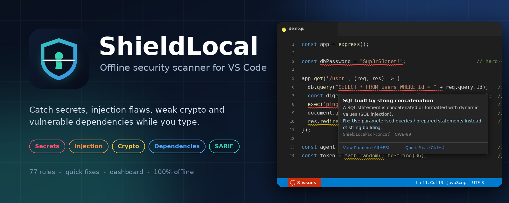
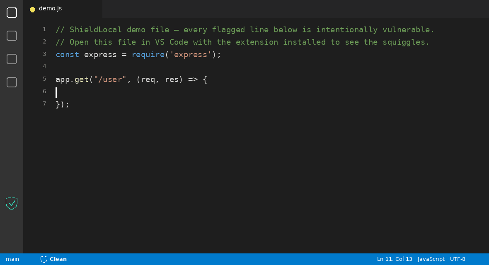
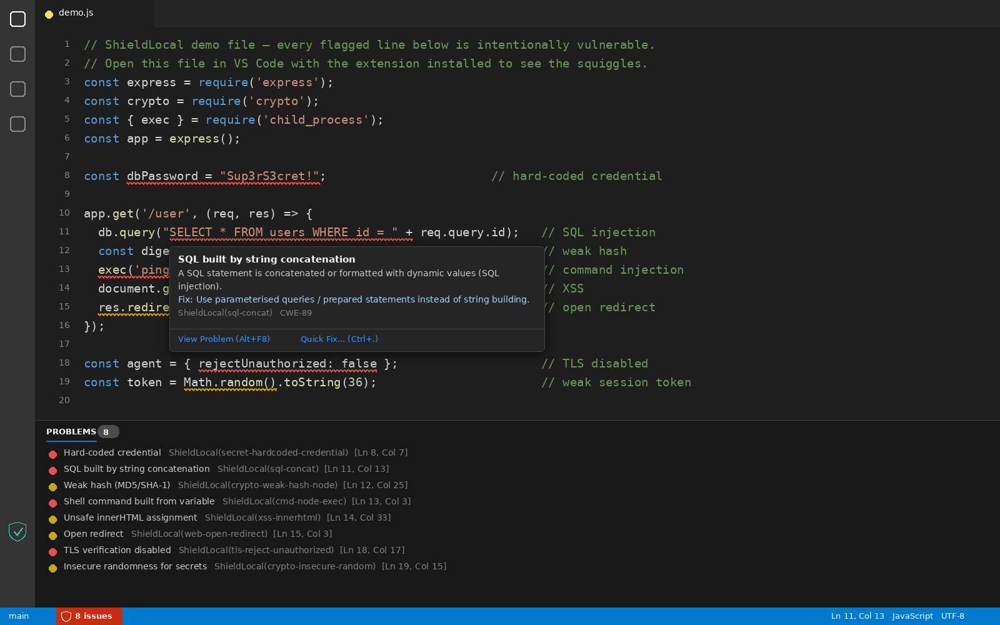
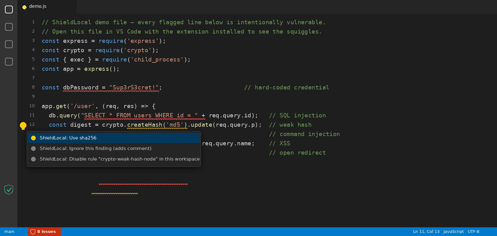
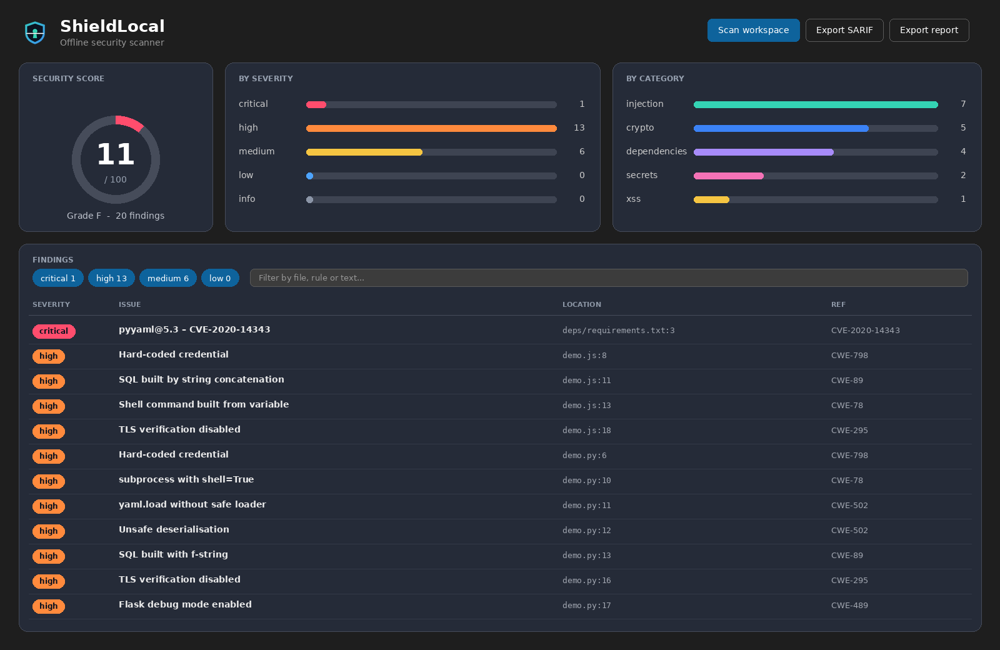
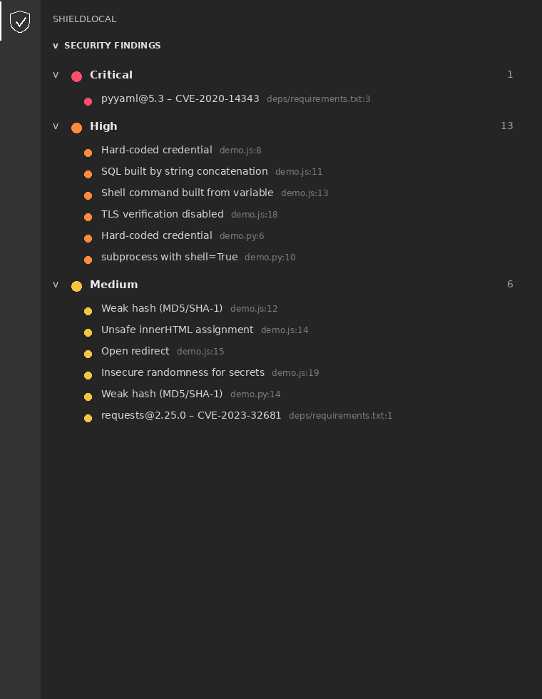

<p align="center">
  
</p>

<p align="center">
  <a href="https://marketplace.visualstudio.com/items?itemName=radwanalmsora.shieldlocal"></a>
  <a href="https://marketplace.visualstudio.com/items?itemName=radwanalmsora.shieldlocal"></a>
  <a href="https://github.com/radwanalmsora/shieldlocal/actions/workflows/build.yml"></a>
  
  
  
</p>

# ShieldLocal — Offline Security Scanner

**Find security problems while you type — without your code ever leaving your machine.**
ShieldLocal is a fast static-analysis (SAST) extension that flags hard-coded secrets, injection flaws, weak cryptography and known-vulnerable dependencies directly in the editor, explains *why* each one matters, and fixes many of them with a single click.

<p align="center"></p>

## Why ShieldLocal?

| | |
|---|---|
| 🔒 **Private by design** | Every rule runs locally. No network calls, no accounts, **zero telemetry**. Safe for proprietary and regulated code. |
| ⚡ **Instant feedback** | Debounced live scanning as you type; a 20 000-line file scans in well under a second. |
| 🛠️ **Fixes, not just warnings** | Quick fixes (`md5` → `sha256`, `verify=False` → `True`, literal secret → `process.env.X`…), per-line ignore, per-rule disable. |
| 📊 **Security dashboard** | Score, severity & category breakdown, searchable findings table. |
| 🧾 **CI-ready** | Export **SARIF** for GitHub Code Scanning, or run the bundled CLI in any pipeline. |
| 🎯 **Low noise** | Placeholders, env look-ups, comments and static strings are understood and skipped. |

## Features

### Real-time diagnostics with context
Hover a finding to see the risk, the recommended fix and a link to the matching **CWE**.

<p align="center"></p>

### One-click quick fixes
Press <kbd>Ctrl</kbd>+<kbd>.</kbd> (<kbd>Cmd</kbd>+<kbd>.</kbd> on macOS) on any finding.

<p align="center"></p>

### Dashboard & sidebar
Scan the whole workspace, track your security score and jump straight to the code.

<p align="center"></p>
<p align="center"></p>

## What it detects (77 rules)

| Category | Examples |
|---|---|
| 🔑 **Secrets** | AWS keys, GitHub / Slack / Stripe / Google tokens, private keys, JWTs, credentials in connection strings, hard-coded passwords & API keys, `.env` secrets |
| 💉 **Injection** | SQL injection (concat, templates, f-strings), command injection, `eval`, `new Function`, SSTI, NoSQL injection, path traversal, open redirect, SSRF |
| 🧨 **XSS** | `innerHTML`, `document.write`, `dangerouslySetInnerHTML`, `v-html`, unescaped PHP echo, `mark_safe`, disabled autoescape |
| ☣️ **Deserialisation** | `pickle`, `yaml.load`, `unserialize`, `ObjectInputStream`, `BinaryFormatter`, `Marshal.load` |
| 🔐 **Crypto & TLS** | MD5/SHA-1, ECB/DES/RC4, `Math.random()` for tokens, disabled certificate verification, JWT `none` |
| ⚙️ **Config** | Wildcard CORS, insecure cookies, Flask/Django debug, `chmod 777`, `curl \| sh`, plain `http://` |
| 📦 **Dependencies** | Known-vulnerable npm & PyPI packages in `package.json`, `package-lock.json`, `requirements.txt` |

**Languages:** JavaScript · TypeScript · React/JSX · Vue · Svelte · HTML · Python · PHP · Java · Go · C# · Ruby · Shell · Dockerfile · YAML · JSON · `.env` · properties/INI/TOML

## Commands

Open the Command Palette (<kbd>Ctrl</kbd>/<kbd>Cmd</kbd>+<kbd>Shift</kbd>+<kbd>P</kbd>) and type **ShieldLocal**.

| Command | Description |
|---|---|
| `ShieldLocal: Scan Workspace` (<kbd>Ctrl</kbd>+<kbd>Alt</kbd>+<kbd>S</kbd>) | Scan every supported file |
| `ShieldLocal: Scan Current File` | Re-scan the active editor |
| `ShieldLocal: Open Dashboard` | Score, charts and findings table |
| `ShieldLocal: Export SARIF Report` | For GitHub Code Scanning and other tools |
| `ShieldLocal: Export Markdown Report` | Shareable human-readable report |
| `ShieldLocal: Browse & Toggle Rules` | See all 77 rules and switch them on/off |

## Ignoring findings

```js
const legacy = eval(code); // shieldlocal-ignore
const x = eval(code);      // shieldlocal-ignore: code-eval
```

Put `shieldlocal-ignore-file` in the first lines of a file to skip it entirely, or use `shieldlocal.excludeGlobs` / `shieldlocal.disabledRules`.

## Settings

| Setting | Default | Description |
|---|---|---|
| `shieldlocal.enable` | `true` | Turn scanning on or off |
| `shieldlocal.scanOnType` | `true` | Scan while typing (debounced) |
| `shieldlocal.minimumSeverity` | `low` | Hide findings below this level |
| `shieldlocal.scanDependencies` | `true` | Check dependency manifests |
| `shieldlocal.disabledRules` | `[]` | Rule IDs to disable |
| `shieldlocal.excludeGlobs` | `[]` | Extra globs skipped by workspace scans |
| `shieldlocal.maxFileSizeKB` | `1024` | Skip files bigger than this |
| `shieldlocal.customAdvisories` | `[]` | Your own advisories (OSV-like ranges) |

## Use it in CI (CLI + GitHub Code Scanning)

The same engine ships as a zero-dependency CLI:

```bash
npx --yes github:radwanalmsora/shieldlocal . --fail-on high   # exit 1 on high/critical findings
npx --yes github:radwanalmsora/shieldlocal . -f sarif -o shieldlocal.sarif
```

```yaml
# .github/workflows/security.yml
- uses: actions/checkout@v4
- run: npx --yes github:radwanalmsora/shieldlocal . -f sarif -o shieldlocal.sarif
- uses: github/codeql-action/upload-sarif@v3
  with: { sarif_file: shieldlocal.sarif }
```

## Privacy

ShieldLocal never sends your code, file names or usage data anywhere. There is no telemetry, no analytics and no network access. Secrets that are detected are **redacted** in dashboards, reports and SARIF output.

## Limitations — please read

ShieldLocal is a fast, pattern-based scanner. It is a great first line of defence, **not** a replacement for code review, a full data-flow SAST tool, or dedicated dependency auditing.

- Rules are line-based, so multi-line constructs can be missed, and some matches may be false positives (use the ignore comments).
- The bundled **advisory data is a small starter set**. Keep using `npm audit`, `pip-audit` or `osv-scanner` for complete coverage, and extend it through `shieldlocal.customAdvisories`.

## Contributing

Rules live in [`src/rules.js`](src/rules.js) and are easy to add — see [CONTRIBUTING.md](CONTRIBUTING.md). Found a false positive or a missing check? [Open an issue](https://github.com/radwanalmsora/shieldlocal/issues).

## License

MIT © radwanalmsora
